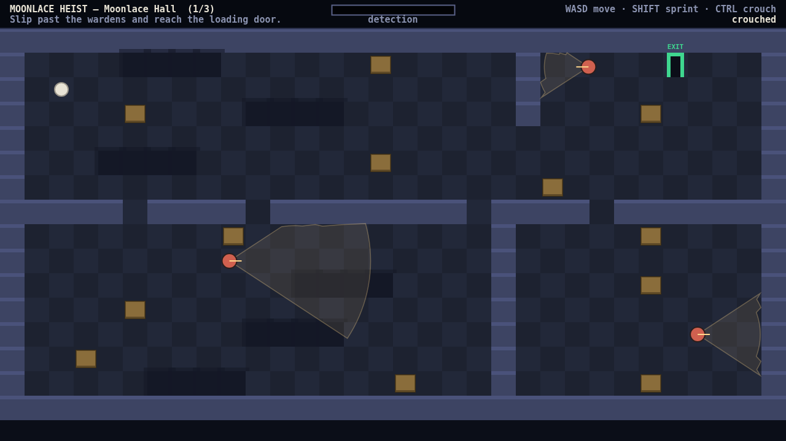

# Moonlace Heist

An original top-down stealth game for the desktop browser: three midnight galleries,
eight wardens on patrol, and one loading door left open. Slip past the vision cones,
crouch into the shadow patches, and reach the exit unseen.



## How it plays

- **WASD / arrows** move, **SHIFT** sprint, **CTRL** or **C** crouch.
- Wardens sweep warm **vision cones** that stop at walls and weaken in shadow.
- Every footstep makes **noise**: sprinting is loud, crouching is near-silent, and a
  warden who hears it leaves the patrol to investigate.
- The **detection meter** fills while a cone holds you and drains once you are out of
  sight — spotted once is not caught: break the line, wait for the search to end, go again.
- Crouch inside a shadow patch and you go **HIDDEN**: barely visible, hard to spot.
- Fill the meter and the alarm turns the wardens red and hunting. Reach the **EXIT** and
  the gallery is cleared.

## The galleries

1. **Moonlace Hall** — three wardens, long sightlines, an L-shaped wall.
2. **Sculpture Wing** — a ring patrol and plinths to break the cones.
3. **Clock Vault** — four wardens and the tall one who never stops walking.

## Source map

| File | Job |
| --- | --- |
| `game/src/config.js` | every tunable: palette, speeds, cone geometry, detection rates |
| `game/src/levels.js` | the three galleries as tile maps with named patrol routes |
| `game/src/world.js` | tile world: parsing, solidity, shadow tests, line of sight, slide movement |
| `game/src/vision.js` | cone geometry: what a warden sees and how strongly |
| `game/src/guards.js` | patrol AI: patrol → suspicious → chase → search → patrol |
| `game/src/player.js` | movement, stance, footstep noise, hiding |
| `game/src/audio.js` | synthesized footsteps, suspicion shimmer, alarm and exit chimes |
| `game/src/state.js` | the state machine: one game object, startLevel, one tick |
| `game/src/render.js` | the painter: floors, cones, wardens, HUD, overlays |
| `game/src/input.js` | keyboard mapping |
| `game/src/shots.js` | staged deterministic frames for the screenshots |
| `game/src/main.js` | bootstrap and the fixed-timestep loop |

All art, names, sounds and levels are original and made for this entry. No engine, no
library, no network: vanilla canvas 2D and Web Audio oscillators only.

## Hand-in

`main.ts` (Node 22, standard library) copies `game/` and `screenshots/` to `/output` and
writes `dossier.json` with `buildDossier` from `vendor/makefun-game.ts`. Try it with:

```
mkdir -p out && MAKEFUN_OUTPUT_DIR=out node main.ts
node serve.ts   # then open http://localhost:8080
```

MIT licensed — see `LICENSE`.


[](https://make.fun/bounty/best-stealth-game-20261121-1759?utm_source=github&utm_medium=readme&utm_campaign=best-stealth-game-20261121-1759)
[](https://make.fun/bounty/best-stealth-game-20261121-1759/leaderboard?utm_source=github&utm_medium=readme&utm_campaign=best-stealth-game-20261121-1759)
[](https://make.fun/bounty/best-stealth-game-20261121-1759?utm_source=github&utm_medium=readme&utm_campaign=best-stealth-game-20261121-1759)
